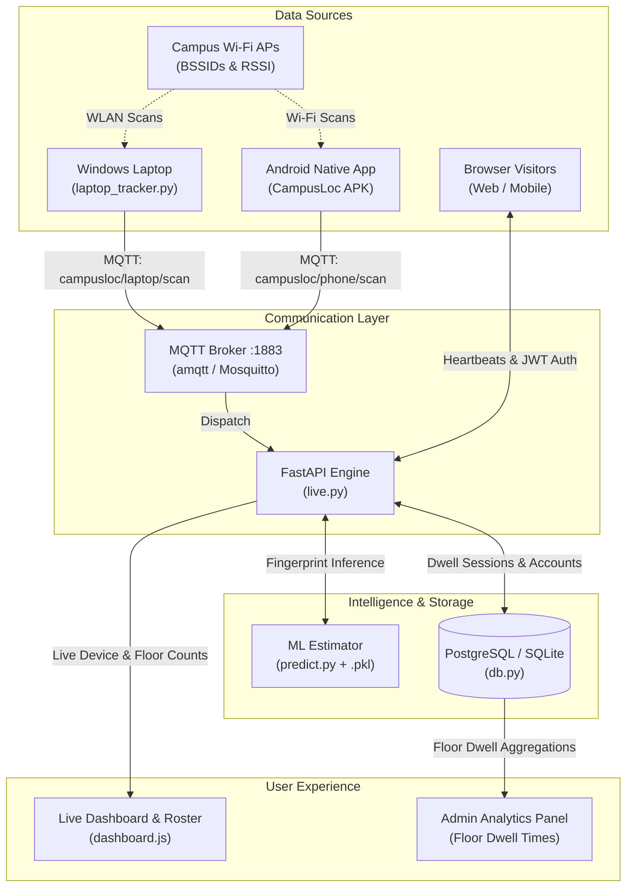

# CampusLoc — Live Campus Indoor Positioning & Floor Dwell Intelligence

[](https://fastapi.tiangolo.com)
[](https://jwt.io)
[](https://render.com)
[](https://campusloc-web-safvenns-projects.vercel.app)
[](https://campusloc-live.onrender.com)

An end-to-end indoor positioning, floor tracking, and dwell-time intelligence platform. CampusLoc determines user levels (**B1, Ground, First, Second, Third, Fourth**) using Wi-Fi fingerprinting, logs real-time presence to a cloud database, and equips administrators with floor-by-floor time analytics.

---

## 🌐 Live Deployments

| Component | Platform | URL |
| :--- | :--- | :--- |
| **Web Dashboard** | **Vercel** | [https://campusloc-web-safvenns-projects.vercel.app](https://campusloc-web-safvenns-projects.vercel.app) |
| **Backend & MQTT** | **Render** | [https://campusloc-live.onrender.com](https://campusloc-live.onrender.com) |
| **Database** | **Render PostgreSQL** | `campusloc-db` (`dpg-db8uhnk9v7es73du9go0-a`, Singapore) |
| **GitHub Repository** | **GitHub** | [https://github.com/safvenn/campusloc-live](https://github.com/safvenn/campusloc-live) |

---

## 🔑 Default Administrator Credentials

To view the **Admin Floor Dwell Time Analytics**:
- **Email:** `admin@campusloc.internal`
- **Password:** `admin123`
*(Or click **🔑 Sign In / Register** ➔ **⚡ Sign in as Admin** on the web dashboard).*

---

## 📑 Contents

- [Overview & Capabilities](#overview--capabilities)
- [System Architecture](#system-architecture)
- [Floor Dwell-Time Tracking Engine](#floor-dwell-time-tracking-engine)
- [Authentication & Role Management](#authentication--role-management)
- [Administrator Analytics Dashboard](#administrator-analytics-dashboard)
- [Multi-Device Tracking (Hardware & Web)](#multi-device-tracking-hardware--web)
- [HTTP API Reference](#http-api-reference)
- [Database Schema](#database-schema)
- [Local Development & Setup](#local-development--setup)
- [Cloud Deployment (Render & Vercel)](#cloud-deployment-render--vercel)
- [Testing & Verification](#testing--verification)

---

## Overview & Capabilities

Traditional GPS signals degrade significantly inside multi-story concrete structures. CampusLoc achieves indoor vertical localization by capturing ambient Wi-Fi access point identifiers (**BSSIDs**) and received signal strengths (**RSSI**, measured in dBm).

### Key Features

1. **Machine Learning Floor Classification:** Evaluates surrounding BSSID fingerprints against a trained estimator bundle (`outputs/wifi_floor_experimental.pkl`) across 6 building floors.
2. **Real-Time Web Visitor Tracking:** When anyone opens the site on a phone or PC, they are automatically identified, assigned a predicted floor based on the campus network, and counted in live building occupancy.
3. **User Authentication (JWT):** Secure user sign-up and sign-in with password hashing (PBKDF2) and 7-day signed JWT tokens.
4. **Floor Dwell-Time Intelligence:** Continuously monitors and records how long users spend on each floor, automatically finalizing sessions when users change floors or leave.
5. **Administrator Analytics View:** Visual dashboard featuring dwell time progress bars per floor, total minutes spent, and a searchable user breakdown table.
6. **Multi-Source Ingestion:** Supports native Android app scans, Windows laptop background scanning, and browser presence heartbeats.

---

## System Architecture



---

## Floor Dwell-Time Tracking Engine

Floor dwell tracking is handled by `record_live_heartbeat()` in `db.py`:

1. **Continuous Session Heartbeats:**
   - As a user stays on a floor, heartbeats update `last_heartbeat` and `ended_at`.
   - Elapsed duration is computed continuously:
     $$\text{duration\_seconds} = \text{ended\_at} - \text{started\_at}$$
2. **Floor Transitions:**
   - If a user moves to another floor (e.g., from *Ground* to *Second*), their active session is closed with its final duration, and a new session starts immediately on the new floor.
3. **Session Eviction on Departure:**
   - If a tab is closed, an unload beacon (`/api/web-user/leave`) is sent.
   - If a device disconnects abruptly, sessions older than 90 seconds expire automatically.

---

## Authentication & Role Management

- **Roles:** `user` (default) and `admin`.
- **JWT Tokens:** Issued on `/api/auth/login` and `/api/auth/register`, containing user ID, email, name, and role.
- **Heartbeat Association:** Web requests send `Authorization: Bearer <token>`, binding real-time floor scans directly to user profiles in the database.

---

## Administrator Analytics Dashboard

Available to authenticated administrators:

- **Total Dwell Monitored:** Aggregate dwell time accumulated across all building levels.
- **Top Visited Floor:** Identifies the highest-traffic floor by cumulative time.
- **Floor-by-Floor Breakdown:**
  - Displays **B1, Ground, First, Second, Third, Fourth**.
  - Shows total minutes, seconds, session count, and animated progress bars indicating percentage share of campus traffic.
- **User Dwell Records Table:**
  - Full audit table detailing User name, Account email, Floor, Total time spent, and last active timestamp with real-time text filtering.

---

## Multi-Device Tracking (Hardware & Web)

### 1. Web Visitors
- Opening the website on mobile or desktop automatically generates a persistent client ID (e.g., `web-a4f91e`).
- Assigns the predicted floor based on the active campus Wi-Fi environment.
- Offers interactive floor chips (`B1` to `Fourth`) allowing users to adjust their location on the map.

### 2. Windows Laptop Scanner (`laptop_tracker.py`)
- Interfaces directly with native Windows `wlanapi.dll` to read real-time BSSIDs and RSSIs.
- Publishes complete scans over MQTT to `campusloc/laptop/scan`.

### 3. Android Application (`android/`)
- Native Java Android app that scans local APs and publishes scans to `campusloc/{device_id}/scan`.
- Displays real-time prediction replies received over `campusloc/{device_id}/prediction`.

---

## HTTP API Reference

### Authentication Endpoints

| Method | Endpoint | Description | Auth Required |
| :--- | :--- | :--- | :--- |
| `POST` | `/api/auth/register` | Register new user account (`email`, `name`, `password`) | No |
| `POST` | `/api/auth/login` | Authenticate user and receive JWT token | No |
| `GET` | `/api/auth/me` | Retrieve authenticated profile | Bearer Token |

### Admin Analytics Endpoints

| Method | Endpoint | Description | Auth Required |
| :--- | :--- | :--- | :--- |
| `GET` | `/api/admin/analytics` | Fetch floor dwell times, session counts, and user breakdowns | Admin Bearer Token |

### Live Presence & Positioning Endpoints

| Method | Endpoint | Description | Auth Required |
| :--- | :--- | :--- | :--- |
| `POST` | `/api/web-user/heartbeat` | Send live presence heartbeat and floor selection | Optional (Links user) |
| `POST` | `/api/web-user/leave` | Gracefully notify server of user departure | No |
| `GET` | `/api/devices` | Get all active devices, predicted floors, and broker state | No |
| `GET` | `/api/latest/{device}` | Get latest scan prediction for a specific device | No |
| `GET` | `/api/history/{device}` | Get recent 60 scan history for a device | No |
| `GET` | `/health` | Server and broker connectivity health check | No |

---

## Database Schema

Implemented in `db.py` for both **PostgreSQL** (production) and **SQLite** (local fallback):

```sql
-- Users and Administrators
CREATE TABLE users (
    id SERIAL PRIMARY KEY,
    email VARCHAR(255) UNIQUE NOT NULL,
    name VARCHAR(255) NOT NULL,
    password_hash VARCHAR(255) NOT NULL,
    role VARCHAR(50) DEFAULT 'user',
    created_at DOUBLE PRECISION NOT NULL
);

-- Continuous Floor Dwell Sessions
CREATE TABLE floor_sessions (
    id SERIAL PRIMARY KEY,
    user_id INTEGER,
    user_email VARCHAR(255),
    user_name VARCHAR(255),
    device_id VARCHAR(64) NOT NULL,
    floor VARCHAR(32) NOT NULL,
    started_at DOUBLE PRECISION NOT NULL,
    ended_at DOUBLE PRECISION NOT NULL,
    duration_seconds DOUBLE PRECISION NOT NULL,
    last_heartbeat DOUBLE PRECISION NOT NULL
);
```

---

## Local Development & Setup

### 1. Clone & Setup Environment

```powershell
git clone https://github.com/safvenn/campusloc-live.git
cd campusloc-live
python -m venv .venv
.\.venv\Scripts\activate
pip install -r requirements-live.txt
```

### 2. Start MQTT Broker

```powershell
# Option A: Built-in Python broker
.\.venv\Scripts\amqtt.exe

# Option B: Docker Compose Mosquitto
docker compose up -d
```

### 3. Start Live Server & Dashboard

```powershell
.\.venv\Scripts\python.exe -m uvicorn live:app --host 0.0.0.0 --port 8000
```

- Open **[http://localhost:8000](http://localhost:8000)** in your browser.
- Open from phones on the same Wi-Fi using `http://YOUR_LOCAL_IP:8000`.

### 4. (Optional) Run Laptop Wi-Fi Scanner

```powershell
.\.venv\Scripts\python.exe laptop_tracker.py --name "My laptop"
```

---

## Cloud Deployment (Render & Vercel)

### Render (FastAPI Backend + PostgreSQL)
1. Managed via Render MCP Blueprint: `render.yaml`.
2. Connects to the Render PostgreSQL instance `campusloc-db`.
3. Auto-deploys from the `main` branch of `safvenn/campusloc-live`.

### Vercel (Web Dashboard)
1. Managed via `vercel.json` and `pyproject.toml`.
2. Deploys the static and dynamic dashboard assets globally.
3. Production URL: **[https://campusloc-web-safvenns-projects.vercel.app](https://campusloc-web-safvenns-projects.vercel.app)**.

---

## Testing & Verification

Run the test suite:

```powershell
.\.venv\Scripts\python.exe -m unittest discover -s tests -v
```

All 9 unit tests cover scan normalization, stale scan rejection, independent device history, web user session handling, and floor prediction edge cases.
