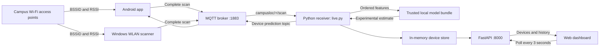

# CampusLoc — Wi-Fi Floor Tracking

An experimental indoor floor tracking system for participating Android phones and Windows laptops.

**Android release:** 1.2 · **Environment:** private LAN / laptop hotspot · **Model:** experimental

> The pipeline is functional, but floor accuracy is not validated for dependable use. The supplied training data contains contradictory labels. Do not use estimates for navigation, emergency response or attendance verification.

## Contents

- [Overview](#overview)
- [Architecture](#architecture)
- [Working flow](#working-flow)
- [Project structure](#project-structure)
- [Technology stack](#technology-stack)
- [Installation](#installation)
- [Hotspot deployment](#hotspot-deployment)
- [Android application](#android-application)
- [Laptop scanner](#laptop-scanner)
- [MQTT protocol](#mqtt-protocol)
- [HTTP API](#http-api)
- [Model and evaluation](#model-and-evaluation)
- [Configuration and operations](#configuration-and-operations)
- [Testing](#testing)
- [Troubleshooting](#troubleshooting)
- [Security and limitations](#security-and-limitations)
- [Roadmap](#roadmap)

## Overview

CampusLoc estimates one of six floors: **B1, Ground, First, Second, Third or Fourth**. A device collects nearby access point identifiers (**BSSIDs**) and received signal strengths (**RSSI**, measured in dBm). This collection is a Wi-Fi fingerprint. A trained Python model maps the fingerprint to an experimental floor estimate.

The system includes Android and Windows collectors, MQTT transport, a Python inference receiver and a multi-device web dashboard. Phones also receive their own predictions over MQTT.

Connecting to a hotspot alone does not identify a person's floor. Each participant must run a scanner and choose to share measurements. Names are self-reported, not verified identities. CampusLoc estimates floors, not rooms or exact coordinates.

### Implemented features

| Component | Features |
| --- | --- |
| Android | Wi-Fi scans, nickname, saved broker URI, runtime permissions, start/stop, MQTT predictions, copy device ID, dashboard shortcut |
| Windows | Native WLAN RSSI readings, continuous/single scans, configurable display name |
| Receiver | Validation, feature alignment, inference, duplicate/order checks, bounded device history |
| Dashboard | All devices, floor counts, search, floor/status filters, individual detail links, history, connection state, APK download |
| Model tooling | Data audit, grouped evaluation, training, JSON prediction, Network Survey CSV import |

## Architecture



### Responsibilities and boundaries

- Android `WifiManager` and Windows `wlanapi` collect signals. A browser cannot perform these scans.
- The MQTT broker transports complete messages; it does not classify floors.
- `live.py` loads the model once at startup and delegates inference to `predict_signals()`.
- `DeviceStore` holds at most 200 devices and 60 accepted results per device. A lock protects HTTP/MQTT access.
- FastAPI serves the dashboard, JSON endpoints and APK. No frontend build step is required.
- Run **one receiver process and one Uvicorn worker**. State is process-local and the receiver MQTT client ID is fixed; additional instances are not supported as a scaling mechanism.

## Working flow

1. A participant starts tracking. Android checks precise location permission, connects to MQTT and subscribes to its prediction topic.
2. The device requests a Wi-Fi scan and filters old/invalid readings. Android keeps the strongest duplicate BSSID measurement.
3. It publishes one complete scan with device ID, nickname, unique scan ID and capture timestamp. Separate scan messages are never combined.
4. The receiver validates payload size, topic/device correspondence, timestamp, BSSID format and RSSI range. Retained scans are ignored.
5. Known BSSIDs are aligned to the model's exact feature order. Unknown APs are ignored; missing model features use **-110 dBm**. At least three recognized APs are required.
6. The model predicts a floor. The live receiver normalizes capitalization. Insufficient recognized APs produce an error without a floor.
7. Duplicate or non-newer results are rejected before storage. Accepted results update latest state and history.
8. A device-specific MQTT reply is published. Android displays only results matching its latest scan ID.
9. The dashboard polls every three seconds and counts only fresh successful estimates.

| Dashboard state | Meaning |
| --- | --- |
| `live` | Fresh successful estimate and receiver connected to broker |
| `unlocated` | Fresh scan received but localization failed |
| `offline` | Result older than 90 seconds, or receiver disconnected from broker |

These are freshness states, not direct presence detection. Stopping an app does not instantly remove its estimate; it expires after 90 seconds. History remains until restart or eviction.

## Project structure

```text
campusloc_model/
├── README.md                 # Full project guide
├── START_HERE.md             # Quick setup
├── live.py                   # MQTT receiver and live web/API service
├── api.py                    # Separate stateless prediction API
├── predict.py                # Shared inference and CLI
├── train_model.py            # Audit, model selection and training
├── laptop_tracker.py         # Windows scanner
├── requirements.txt          # Base Python dependencies
├── requirements-live.txt     # Base dependencies plus MQTT
├── compose.yaml              # Mosquitto Docker service
├── broker/mosquitto.conf
├── outputs/
│   ├── wifi_floor_experimental.pkl
│   └── evaluation.json
├── web/
│   ├── index.html
│   ├── dashboard.css
│   ├── dashboard.js
│   └── single-device-original.html  # Archived original UI
├── tests/test_live.py
├── android/
│   ├── app/src/main/AndroidManifest.xml
│   ├── app/src/main/java/com/campusloc/app/MainActivity.java
│   ├── app/build.gradle
│   └── gradlew.bat
└── dist/CampusLoc-debug.apk   # Generated Android package
```

`.venv/`, `.build-tools/`, `.runtime/` and Python caches are ignored local artifacts. They are not portable installation requirements.

## Technology stack

| Layer | Implementation |
| --- | --- |
| Android | Java 17, native views, WifiManager, Paho MQTT 1.2.5 |
| Android build | Gradle 8.11.1, AGP 8.9.2, SDK 35 |
| Backend | Python, FastAPI, Uvicorn, Paho MQTT 2.x |
| ML | scikit-learn 1.8.0, pandas, NumPy, joblib |
| Windows | ctypes and Windows WLAN API |
| Broker | Mosquitto 2 or compatible MQTT broker |
| Frontend | HTML, CSS, vanilla JavaScript |
| Storage | In-memory dictionaries and bounded deques |

Android minimum is **8.0 / API 26**, target API 35. Python components have run locally under Python 3.14; package compatibility can vary by platform.

## Installation

Use PowerShell from the repository root unless noted otherwise.

### 1. Python environment

```powershell
py -3.12 -m venv .venv
.\.venv\Scripts\python.exe -m pip install -r requirements-live.txt
```

Use another installed compatible Python version if necessary. Preserve the scikit-learn 1.8.0 pin to match the serialized model.

### 2. Start one MQTT broker

With Docker Desktop running:

```powershell
docker compose up -d
```

Alternatively, with Mosquitto installed on PATH:

```powershell
mosquitto -c broker/mosquitto.conf
```

The initial integration run used this optional local alternative:

```powershell
.\.venv\Scripts\python.exe -m pip install amqtt==0.12.1
.\.venv\Scripts\amqtt.exe
```

AMQTT is not part of the project requirements. Start only one broker on port 1883. These development configurations allow anonymous clients and belong on a trusted private network.

### 3. Start receiver and dashboard

In another terminal:

```powershell
.\.venv\Scripts\python.exe -m uvicorn live:app --host 0.0.0.0 --port 8000
```

Open [the dashboard](http://localhost:8000/) and [health endpoint](http://localhost:8000/health). Confirm `broker_connected` is `true`; HTTP availability alone does not prove MQTT connectivity.

### 4. Start a collector

```powershell
.\.venv\Scripts\python.exe laptop_tracker.py --name "My laptop"
```

Or install [the Android APK](dist/CampusLoc-debug.apk) and follow the phone setup below. Devices appear automatically after an accepted scan.

## Hotspot deployment

1. Enable Windows Mobile hotspot, or connect devices to a reachable shared LAN.
2. Run `ipconfig` and identify the laptop IPv4 address on the adapter used by the phones. Hotspot and regular Wi-Fi addresses may differ.
3. Enter `tcp://LAPTOP_IP:1883` in each phone.
4. Open `http://LAPTOP_IP:8000` on the phone. Choose **Connect a device** for the APK link and instructions.
5. If blocked, allow TCP ports 1883 and 8000 on the appropriate private firewall profile. Do not disable the firewall globally.
6. Each participant chooses a nickname, grants permission and starts tracking with the app visible.

`localhost` on a phone means that phone, not the laptop. Campus networks may isolate clients despite sharing an SSID. Hotspot coverage across floors is not guaranteed.

## Android application

### Personal location dashboard (1.2)

The default **My location** panel shows your estimated floor, a six-floor building view with the matching floor highlighted, time since the latest result, recognized/detected access point counts and broker connection state. It uses the phone's own MQTT prediction; it does not open a browser or require the web dashboard to remain visible.

**Connection setup** opens a second panel in the same activity, so switching panels keeps scans active. Stopping tracking, losing the broker connection or letting an estimate expire clears the floor highlight. The separate shared-website shortcut still opens a browser and stops scans. The model provides floor estimates only, not room names, building identity or GPS coordinates.

### Building

Install Android Studio or provide JDK 17, SDK platform 35 and build tools 35.0.0. For terminal builds set `JAVA_HOME` and `ANDROID_HOME`.

```powershell
cd android
.\gradlew.bat assembleDebug
```

Output: `android/app/build/outputs/apk/debug/app-debug.apk`.

Update the website download from the repository root:

```powershell
New-Item -ItemType Directory -Force dist | Out-Null
Copy-Item android/app/build/outputs/apk/debug/app-debug.apk dist/CampusLoc-debug.apk
```

This is a debug-signed development package. Release signing and store distribution are not configured. Updates require a compatible signing key; same-key updates retain preferences and ID. Uninstalling clears app data.

### Usage

Install on a physical phone, choose a nickname of up to 40 characters, and enter the broker URI and optional credentials. Enable Wi-Fi and Location, grant precise location permission, then tap **Start tracking**.

The app stores its random device ID, nickname and broker URI in private preferences. The MQTT password is not saved. `ssl://HOST:8883` supports a correctly configured broker with a trusted certificate; there is no custom certificate-import UI.

Scanning runs every 35 seconds while the activity is visible. Leaving it, locking the phone or opening the dashboard shortcut stops tracking. Return and tap Start to resume. View the dashboard on the laptop to keep phones scanning. Android may throttle scans. Automatic MQTT reconnection handles connection loss; an initial failure requires starting again.

## Laptop scanner

```powershell
# One scan
.\.venv\Scripts\python.exe laptop_tracker.py --once

# Continuous scans
.\.venv\Scripts\python.exe laptop_tracker.py --name "Lab laptop"
```

The scanner reads actual RSSI through Windows WLAN APIs, not estimated values from signal percentages. A single-adapter cycle takes approximately five seconds for scanning plus a 30-second pause. More adapters can increase the interval. Ctrl+C stops foreground scanning.

Current fixed settings are device ID `laptop`, client ID `campusloc-laptop-scanner` and broker `localhost:1883`. Only one laptop collector is supported per deployment without code changes. `--name` changes the display name, not identity. Configurable broker/authentication and comprehensive WLAN failure recovery are not implemented.

## MQTT protocol

| Direction | Topic | QoS | Retained |
| --- | --- | --- | --- |
| Scanner → receiver | `campusloc/{device_id}/scan` | 1 | No |
| Receiver → Android | `campusloc/{device_id}/prediction` | 1 | No |

The receiver subscribes to `campusloc/+/scan`. QoS 1 can redeliver messages; ID/timestamp checks prevent repeated history entries. No durable offline replay is implemented.

### Scan payload example

```json
{
  "device_id": "phone-1",
  "display_name": "Student A",
  "scan_id": "unique-scan-id",
  "captured_at": 1792100000.0,
  "signals": {
    "aa:bb:cc:dd:ee:01": -58,
    "aa:bb:cc:dd:ee:02": -74,
    "aa:bb:cc:dd:ee:03": -81
  }
}
```

This is a schema example, not a usable fingerprint. Replace the timestamp with current Unix seconds and BSSIDs with real model-recognized APs.

| Constraint | Requirement |
| --- | --- |
| Device/scan IDs | 1–64 characters: letters, digits, underscore or hyphen |
| Topic ID | Must equal payload device ID |
| Display name | Optional, defaults to ID; trimmed length 1–40; no control characters |
| Timestamp | Finite number, no more than 90 seconds old or 30 seconds ahead |
| Signals | Mapping with 1–1,000 readings |
| BSSID | Six colon-separated hexadecimal octets; live matching is case-insensitive |
| RSSI | Finite number from -110 through 0; no booleans |
| Payload size | At most 128,000 bytes at receiver |
| Ordering | Newer timestamp than the stored result for that device |

Successful replies include identity, name, scan ID, timestamps, detected AP count, predicted floor, experimental status, recognized/total model AP counts and a warning message. Optional `uncalibrated_model_scores` are not reliable location confidence and are not displayed as such.

Valid unlocalizable scans return `status: cannot_localize` and an error, without a floor. Malformed, retained, stale, duplicate and out-of-order messages are discarded and may receive no reply.

The separate Network Survey app's MQTT format is not directly supported. Its CSV files can be imported through `predict.py`.

## HTTP API

### Live service: `live:app`

| Method | Path | Response |
| --- | --- | --- |
| GET | `/` | Dashboard |
| GET | `/assets/{path}` | Files from `web/` |
| GET | `/health` | Broker connection flag and experimental status |
| GET | `/api/devices` | Devices sorted by display name and broker flag |
| GET | `/api/latest/{device}` | Latest result with freshness; 404 if unknown |
| GET | `/api/history/{device}` | `history` array, oldest first, maximum 60; 404 if unknown |
| GET | `/download/android` | Built APK; 404 if absent |
| GET | `/docs` | Generated API documentation |

Direct links such as `/?device=laptop` open device details. The API preserves a stale floor value: consumers must inspect `stale`, `broker_connected` and `connection_status`. The UI excludes stale estimates from floor counts.

### Separate inference service: `api:app`

This stateless service does not update live device state. Use another port when both are running:

```powershell
.\.venv\Scripts\python.exe -m uvicorn api:app --host 127.0.0.1 --port 8001
```

`GET /health` reports model readiness and selection. `POST /predict` accepts:

```json
{"signals": {"MODEL_BSSID_1": -58, "MODEL_BSSID_2": -74, "MODEL_BSSID_3": -81}}
```

Replace placeholders with exact model feature names. Unlike the live receiver, this route does not normalize BSSID case. Invalid input returns HTTP 422. Labels may retain their training capitalization.

## Model and evaluation

The trusted bundle contains the estimator, feature order, classes, missing-value convention and training metadata. Never load untrusted pickle/joblib files: deserialization can execute code.

### Recorded results

Values are from [evaluation.json](outputs/evaluation.json), not independent field validation.

| Metric | Value |
| --- | ---: |
| Dataset rows | 693 |
| BSSID features | 100 |
| Unique fingerprints | 259 |
| Fingerprints with conflicting labels | 137 |
| Rows affected by conflicts | 568 |
| Deterministic in-sample label-matching upper bound | 37.81% |
| Selected model | `logistic_balanced` |
| Holdout train/test rows | 517 / 176 |
| Holdout accuracy | 35.80% |
| Holdout macro-F1 | 0.3110 |
| Holdout balanced accuracy | 41.43% |

The 37.81% bound applies to these contradictory rows and features, not to a correctly collected future dataset.

Identical fingerprints are grouped so they cannot cross training/test boundaries. A grouped outer split creates the holdout. Three-fold grouped inner validation selects a non-baseline model by macro-F1, then accuracy for ties. After evaluation, the selected model is fitted on all rows for the experimental artifact. Independent correctly labeled survey sessions were unavailable.

### Retraining

Provide the original CSV; it is not assumed to be included:

```powershell
.\.venv\Scripts\python.exe train_model.py --csv "wifi1-data (1).csv" --out outputs
```

This replaces model/evaluation artifacts in the output directory. Preserve earlier experiments as needed. Restart inference services afterward. The script selects BSSID columns, excludes unrelated fields, encodes missing APs as -110 and reports conflicts rather than silently repairing labels.

### Network Survey CSV prediction

```powershell
.\.venv\Scripts\python.exe predict.py --scan "survey.csv"
```

Required columns: `deviceTime`, `bssid`, `signalStrength`. The importer chooses the maximum distinct timestamp and averages duplicate BSSIDs in that group. Timestamps must be consistently sortable and correspond to actual scans. Arbitrary overlapping sessions are not reconstructed.

### Improving reliability

Collect original sessions on all floors, at multiple positions and times, using multiple phones. Record session IDs and ground truth at collection time. Investigate contradictory fingerprints against originals; do not copy fingerprints and change only labels. Improve B1 coverage, hold out independent sessions, and measure macro-F1, balanced accuracy and confusion matrices on a blind on-site test.

## Configuration and operations

| Receiver variable | Default | Purpose |
| --- | --- | --- |
| `MQTT_HOST` | `localhost` | Broker address |
| `MQTT_PORT` | `1883` | Broker port |
| `MQTT_USERNAME` | Unset | Username authentication |
| `MQTT_PASSWORD` | Unset | Password with username |
| `MQTT_TLS` | Unset | Set `1` for certificate-verified TLS |
| `MQTT_CA_FILE` | Unset | Optional trusted CA file |

These configure the receiver only. Android has its own settings; the current laptop scanner does not read these variables.

- Restart clears latest results and history. New scans repopulate the dashboard.
- At 200 devices, a newly seen device evicts the least recently received device and its history.
- Only 60 accepted results per device are retained. There is no database.
- Prediction metadata is stored, not raw BSSID/RSSI history. Names, IDs, timestamps, counts and scores remain in memory.
- No startup-on-boot service is configured.
- Use Ctrl+C for foreground processes and `docker compose down` for the Docker broker.
- Development background logs may be in `.runtime/`; identify exact process command lines before stopping them.

## Testing

```powershell
.\.venv\Scripts\python.exe -m unittest discover -s tests -v
```

Eight tests cover feature mapping, invalid readings/names, stale timestamps, topic mismatch, unlocalizable results, freshness states, device isolation, duplicate/order rejection, history bounds and eviction.

Additional development checks completed: actual-model synthetic inference; MQTT-to-dashboard flow; two-device independent histories; real Windows scans; browser roster/filter/setup checks; Android 1.1 compilation, signature verification and APK download.

**Pending:** physical-phone installation/scanning, multi-phone cross-floor hotspot tests, load testing, production security and reliable field accuracy. Functional tests do not establish prediction accuracy.

## Troubleshooting

| Problem | Check |
| --- | --- |
| Port occupied | Inspect `Get-NetTCPConnection -State Listen -LocalPort 1883,8000`; identify the existing process |
| Broker disconnected | Broker process, host, port, credentials and TLS |
| Phone cannot connect | Correct laptop adapter IP, private firewall rules and client isolation |
| Cross-floor connectivity fails | Hotspot coverage; model inference cannot restore connectivity |
| Android scan unavailable | Wi-Fi, Location, precise permission, app visibility and OS throttling |
| Tracking stops after dashboard shortcut | Expected activity lifecycle; view dashboard on laptop |
| Windows WLAN error | Wi-Fi adapter and Windows Location access; restart after resolving error |
| Cannot localize | At least three model BSSIDs required; new buildings/APs need new data |
| Floor jumps | Signal variability and conflicting labels; scores are not calibrated confidence |
| Stale device | Scanner/app, connection and clocks; 90-second freshness window |
| Missing history | Receiver restart or device eviction |
| APK download 404 | Build and copy APK into `dist/` |
| APK update fails | Android version and signing compatibility; uninstalling loses preferences |
| Gradle timeout | Network access and retry; local tooling may exist under `.build-tools/` |

## Security and limitations

The Android UI explains sharing and provides stopping controls. Stopping does not erase past estimates from memory. Dashboard/API authentication is absent: anyone with network access can view device names and estimates.

The development broker accepts anonymous clients. IDs/topics are not authentication and do not prevent impersonation. HTTP and `tcp://` MQTT are unencrypted. BSSIDs identify infrastructure and floor estimates can be sensitive.

Use a trusted private network. Wider deployment needs HTTPS authentication, broker credentials and per-device topic ACLs, TLS, verified enrollment, consent/retention controls, rate limiting, monitoring and a validated model. These are not currently implemented. The app does not covertly discover people or collect phone scans in the background.

## Roadmap

Proposals, not shipped features:

1. Trustworthy survey sessions and independent accuracy validation.
2. Secure enrollment, authenticated dashboards and MQTT permissions.
3. Multiple Windows collectors with configurable IDs and broker settings.
4. Persistent storage with explicit retention/deletion policy.
5. Temporal smoothing evaluated against ground truth.
6. Opt-in Android foreground service with a persistent notification.
7. Release signing, physical-device tests and automated builds.

## Project status and licensing

This is a research/development prototype. No project license file is included; do not assume redistribution rights. Third-party dependencies retain their own licenses. See [START_HERE.md](START_HERE.md) for the quick setup guide.
